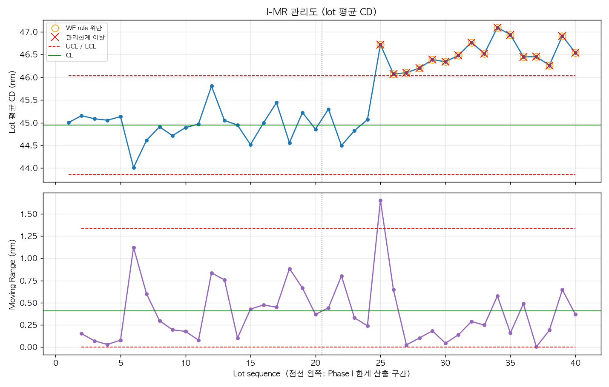
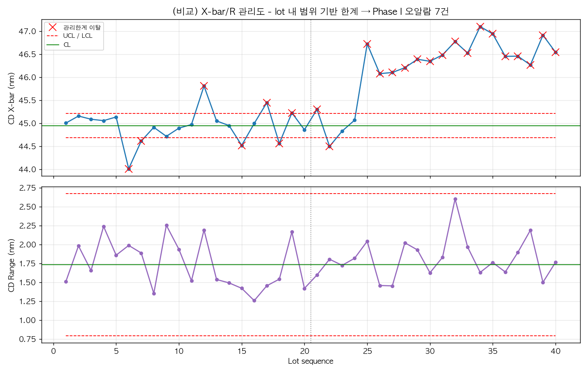
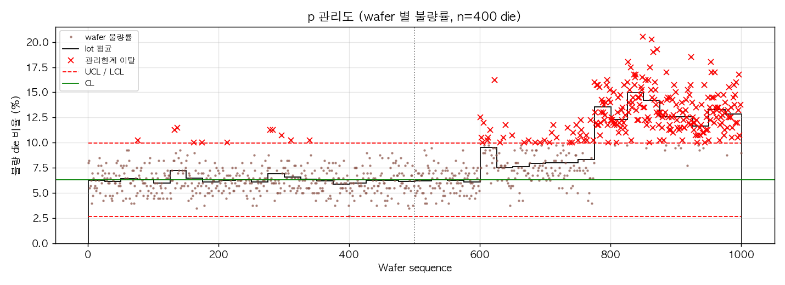
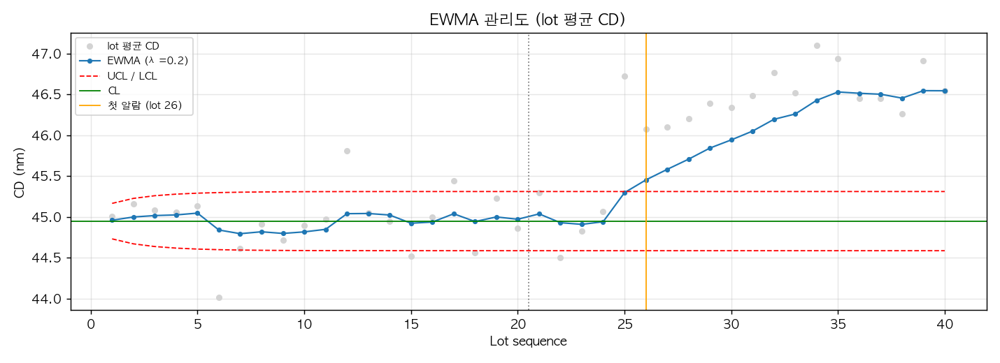
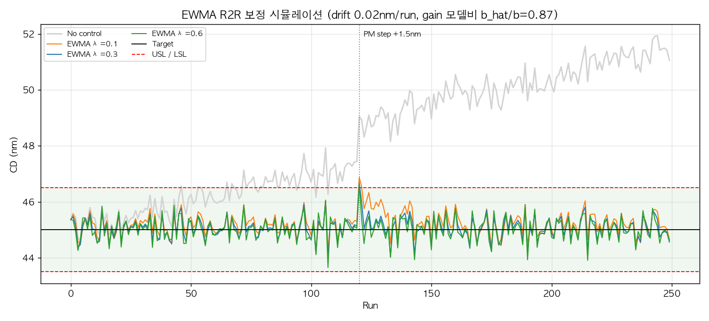
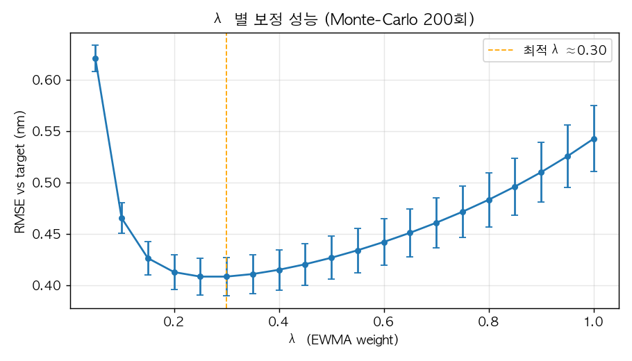

# wafer-yield-failure-analysis
Semiconductor wafer yield and failure pattern analysis

웨이퍼 공정 데이터로 **SPC 관리도**를 그려 공정 이상을 검출하고, **EWMA Run-to-Run(R2R) 보정**으로 drift·shift를 자동으로 잡는 과정을 시뮬레이션합니다.

## 실행 방법

```bash
pip install -r requirements.txt
python main.py
```

`main.py`를 실행하면 아래 세 단계가 차례로 돌고, 결과는 `data/`와 `figures/`에 저장됩니다.

| 단계 | 스크립트 | 출력 |
|---|---|---|
| 1. 가상 웨이퍼 데이터 생성 | `src/generate_wafer_data.py` | `data/wafer_data.csv` |
| 2. SPC 관리도 | `src/control_charts.py` | `figures/imr_chart.png`, `p_chart.png`, `ewma_chart.png`, `xbar_r_chart_naive.png` |
| 3. EWMA R2R 보정 시뮬레이션 | `src/ewma_r2r.py` | `figures/ewma_r2r_simulation.png`, `ewma_lambda_sweep.png`, `data/ewma_r2r_*.csv` |

## 1. 데이터

`seed=42`로 고정한 가상 데이터입니다. 40 lot × 25 wafer = 1,000 wafer이고, wafer마다 9개 site에서 CD(Critical Dimension, target 45 nm)를 측정하고 die 400개 중 불량 수를 기록합니다.

| 변동 성분 | σ |
|---|---|
| lot 간 | 0.3 nm |
| wafer 간 | 0.4 nm |
| wafer 내 site 간 | 0.6 nm |

검출 대상으로 다음 두 이상을 의도적으로 넣었습니다.
- **lot 25부터**: 장비 PM 이후 CD가 **+1.5 nm step shift**
- **lot 32부터**: 파티클 이슈로 기본 불량률이 6%에서 10%로 증가

불량 확률은 CD가 target에서 벗어난 정도의 제곱에 비례해 커지므로, CD shift가 생기면 수율도 떨어집니다.

주요 컬럼: `lot_id, lot_seq, wafer_id, cd_site1..9, cd_mean, cd_range, total_die, fail_die, yield_pct`

## 2. SPC 관리도

관리한계는 **Phase I(정상 구간인 lot 1~20)**에서 구하고, 이후 lot에도 같은 한계를 적용합니다(Phase II 모니터링).

### I-MR 관리도 (lot 평균 CD)


- CL 44.95 nm, UCL 46.04 nm, LCL 43.86 nm
- shift가 시작된 **lot 25에서 바로 관리한계를 벗어났고**, 이후 모든 lot이 Western Electric 규칙을 위반합니다.
- Phase I 구간에는 오알람이 없습니다.

### (비교) lot 내 범위로 한계를 잡은 X-bar/R 관리도


subgroup을 lot(n=25 wafer)으로 두고 **lot 내 범위(R)만으로** 한계를 계산하면, lot 간 변동이 한계에 반영되지 않아 폭이 지나치게 좁아집니다. 그 결과 정상 구간에서도 **오알람이 7건** 발생합니다. 배치 공정에서는 변동 구조(nested variance)에 맞게 subgroup과 σ를 정해야 한다는 점을 보여 주는 예시입니다.

### p 관리도 (wafer별 불량률)


- CL 6.32%이고, Phase II에서 **lot 25부터 이탈이 급증**합니다. lot 32 이후에는 파티클 이슈가 겹쳐 대부분의 wafer가 UCL을 넘습니다.
- Phase I에서 500장 중 11장이 이탈했는데, 이항분포 기준 기댓값(약 1.4장)보다 많습니다. lot 간 CD 변동이 불량률에 과분산(overdispersion)을 만들기 때문이며, 실무에서는 Laney p′ 관리도로 보완할 수 있습니다.

### EWMA 관리도 (lot 평균 CD, λ=0.2)


과거 값에 가중치를 누적해 작은 shift에 민감하게 반응하도록 만든 관리도입니다. 이번 데이터는 shift가 1.5 nm(약 4σ_lot)로 커서 Shewhart 계열인 I-MR이 한 lot 더 빨리 잡았습니다(I-MR은 lot 25, EWMA는 lot 26). σ의 1~2배 정도인 작은 shift에서는 EWMA가 더 유리합니다.

## 3. EWMA Run-to-Run 보정 시뮬레이션

### 모델

```
공정:  y_t = a + b·u_t + d_t + e_t
        d_t = 0.02 nm/run drift + (run 120 이후 PM step +1.5 nm)
        e_t ~ N(0, 0.35²)

EWMA 컨트롤러 (gain 추정치 b̂ = 1.3, 실제 b = 1.5):
        â_t     = λ·(y_t − b̂·u_t) + (1 − λ)·â_{t−1}
        u_{t+1} = (Target − â_t) / b̂
```

컨트롤러는 run마다 측정값으로 공정 절편(offset)을 EWMA로 갱신하고, 다음 run의 레시피(u)를 보정합니다. 모델 gain이 실제보다 13% 작은 상황, 즉 모델 오차가 있는 경우를 가정했습니다.

### 결과


| 시나리오 | 평균 (nm) | σ (nm) | RMSE (nm) | Cpk | Spec-out | Step 직후 20 run 평균 편차 |
|---|---|---|---|---|---|---|
| No control | 48.27 | 2.15 | 3.91 | −0.27 | 71.2 % | +3.96 |
| EWMA λ=0.1 | 45.22 | 0.40 | 0.46 | 1.07 | 0.8 % | +0.74 |
| **EWMA λ=0.3** | **45.07** | **0.39** | **0.39** | **1.23** | **0.4 %** | +0.27 |
| EWMA λ=0.6 | 45.04 | 0.42 | 0.42 | 1.15 | 0.4 % | +0.15 |

(Spec 45 ± 1.5 nm)

- 보정을 하지 않으면 drift가 계속 쌓이고 PM step까지 더해져 **71%가 spec을 벗어납니다**. EWMA 보정을 적용하면 Cpk가 1.0을 넘습니다.
- **λ가 작으면**(0.1) 노이즈에는 둔감하지만 step shift를 따라잡는 데 오래 걸리고, drift가 있으면 평균이 계속 target에서 어긋납니다(bias +0.22 nm).
- **λ가 크면**(0.6) 회복은 빠르지만 측정 노이즈까지 레시피에 반영되어 σ가 커집니다.

### λ 최적화 (Monte-Carlo 200회)


이 조건(노이즈 0.35 nm, drift 0.02 nm/run, step 1.5 nm)에서 RMSE가 가장 작은 λ는 **약 0.3**입니다. 0.2~0.4 구간에서는 RMSE 차이가 0.01 nm 이내로 거의 없습니다. drift가 큰 공정이라면 Double-EWMA(predictor-corrector) 컨트롤러로 drift 성분을 따로 추정하는 방식도 고려할 수 있습니다.

## 프로젝트 구조

```
├── main.py
├── requirements.txt
├── src/
│   ├── generate_wafer_data.py   # 가상 lot/wafer/site 데이터 생성
│   ├── control_charts.py        # I-MR, X-bar/R, p, EWMA 관리도 + WE rules
│   ├── ewma_r2r.py              # EWMA R2R 보정 시뮬레이션 + λ sweep
│   └── font_setup.py            # matplotlib 한글 폰트 설정
├── data/                        # 생성 데이터 및 시뮬레이션 결과 CSV
└── figures/                     # 관리도 및 시뮬레이션 그래프
```
